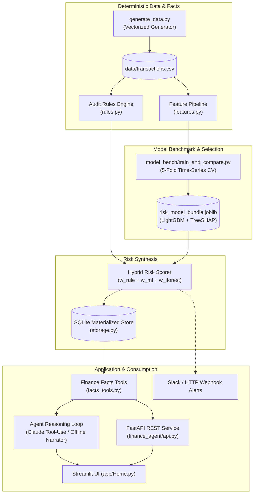

# FinSight Agent

[](https://github.com/themanoj-025/FinSight/actions/workflows/ci.yml)
[](./LICENSE)
[](https://www.python.org/)
[](#model-benchmark)
[](#model-benchmark)
[](tests/)

Autonomous personal finance analyst that transforms raw bank transaction ledgers
into fraud alerts, spending insights, and plain-English financial advice using
honest time-series ML benchmarking, TreeSHAP explainability, and a hybrid
rules-plus-LLM reasoning engine.

---

## Quick Facts

| Dimension | Details |
| --- | --- |
| **Domain** | FinTech Intelligence, Fraud Detection & Personal Finance Analytics |
| **Core Architecture** | Deterministic facts layer + Hybrid risk blend + Streamlit UI + FastAPI |
| **Benchmarked Models** | 6 models (LightGBM winner, Random Forest, Logistic Reg, SGD SVM, Isolation Forest, MLP) |
| **Evaluation Standard** | 5-fold temporal cross-validation scored strictly by PR-AUC (no leakage) |
| **Explainability** | Native LightGBM TreeSHAP per-transaction feature attribution log-odds |
| **Agent Core** | Bounded Anthropic Claude tool-use loop with zero-credential offline narrator fallback |
| **Test Coverage** | 302 collected tests across 26 unit, property, and integration suites |
| **License** | [MIT License](./LICENSE) |

---

## Table of Contents

- [What It Does](#what-it-does)
- [Screenshots](#screenshots)
- [Key Features](#key-features)
- [Model Benchmark](#model-benchmark)
- [Architecture](#architecture)
- [Tech Stack](#tech-stack)
- [Prerequisites](#prerequisites)
- [Quick Start](#quick-start)
- [Configuration](#configuration)
- [Project Structure](#project-structure)
- [API Reference](#api-reference)
- [Testing](#testing)
- [Limitations](#limitations)
- [Contributing](#contributing)
- [Security](#security)
- [License](#license)

---

## What It Does

Standard fraud detection examples frequently evaluate static datasets with overall
accuracy metrics that misrepresent performance on heavily imbalanced fraud distributions
(~1–2% positive class). Furthermore, conversational LLM interfaces often fabricate
financial quantities when querying bank statements.

**FinSight Agent** resolves these shortcomings:
1. **Deterministic Vectorized Ledger Generator:** Generates multi-persona transactional
   histories across 6 consumer archetypes, enforcing strict balance conservation and
   injecting a 15-pattern difficulty-graded fraud library.
2. **Honest Time-Series Evaluation:** Compares 6 supervised and unsupervised estimators
   using strictly backward-looking features across temporal folds without future leakage.
3. **Tri-Partite Risk Blending:** Blends rule-based audit heuristics, supervised
   LightGBM probabilities, and Isolation Forest anomaly scores into an actionable composite index.
4. **Grounded Agentic Reasoning:** Answers user inquiries via a bounded Anthropic Claude
   tool loop that speaks exclusively from computed facts, accompanied by an offline
   deterministic narrator when API keys are absent.
5. **Granular Explanations:** Employs TreeSHAP attributions so consumers and compliance
   auditors can inspect why individual transactions were flagged.

---

## Screenshots

<!-- TODO[L2-01]: Add dashboard transaction view and fraud risk scan screenshots from running Streamlit instance -->
> *Interactive personal finance overview, risk scan with TreeSHAP feature contributions, and agent chat.*

---

## Key Features

- **Synthetic Ledger Generator:** Vectorized generator with three distinct tiers
  (`tiny` for CI testing, `demo` for interactive app exploration, and `bench` for
  rigorous million-row benchmarking).
- **Leakage-Free Feature Engineering:** Rolling velocity windows, merchant entropy,
  and distance-to-home metrics computed strictly over historical timelines.
- **Explainable Fraud Triage:** Interactive TreeSHAP waterfall charts break down
  every flagged charge into baseline bias and specific feature contributions.
- **Fail-Safe Agent Fallback:** Functions 100% offline with zero external API credentials
  by falling back to a deterministic rule-based narrator.
- **Outbound Webhook Alerts:** Dispatches deduplicated risk alerts to Slack or
  custom HTTP endpoints when suspicious transactions exceed safety thresholds.
- **Dual Runtime Modes:** Operates embedded in-process or as a decoupled client
  communicating with the versioned FastAPI facts microservice.

---

## Model Benchmark

All estimators were trained and evaluated on bench-tier data using 5-fold temporal
cross-validation. In imbalanced fraud detection, PR-AUC serves as the primary metric:

| Model Family | Mean PR-AUC (± Std) | ROC-AUC | F1-Score | Status |
| --- | --- | --- | --- | --- |
| Random Forest | 0.855 ± 0.057 | 0.994 | 0.608 | Baseline Champion |
| **LightGBM** | **0.828 ± 0.055** | **0.998** | **0.733** | **Selected Winner (SHAP Preferred)** |
| Logistic Regression | 0.536 ± 0.117 | 0.991 | 0.297 | Linear Baseline |
| MLP Autoencoder | 0.287 ± 0.093 | 0.950 | 0.252 | Unsupervised Neural |
| SGD (Linear SVM) | 0.164 ± 0.042 | 0.973 | 0.277 | Linear Hyperplane |
| Isolation Forest | 0.154 ± 0.081 | 0.962 | 0.090 | Tree Anomaly Detector |

*Selection Rationale:* While Random Forest scored marginally higher in raw PR-AUC,
LightGBM was selected as the production model due to superior F1 performance,
faster inference velocity, and native TreeSHAP tree support.

---

## Architecture



### Architectural Principles

- **Separation of Facts and Narrative:** The reasoning agent never computes math
  or tallies sums directly; it invokes facts tools and reports strictly on verified outputs.
- **Signed Model Bundles:** Production model artifacts support HMAC signing and
  verification (`bundle_security.py`) to prevent untrusted deserialization.
- **In-Memory and DB Caching:** Materialized risk scores persist to SQLite,
  preventing duplicate recomputation across user dashboard sessions.

---

## Tech Stack

| Component | Library / Framework | Version | Purpose |
| --- | --- | --- | --- |
| **Language** | Python | `>=3.10, <3.13` | Core runtime |
| **Gradient Boosting** | LightGBM | `>=4.0, <5.0` | Primary fraud classification and TreeSHAP |
| **Machine Learning** | scikit-learn | `>=1.4, <1.9` | Isolation Forest, SGD, Random Forest, metrics |
| **Data Engine** | Pandas & NumPy | Latest | Vectorized transaction generation and rolling features |
| **Web Portal** | Streamlit | `>=1.47, <1.66` | Multi-page interactive personal finance application |
| **REST Service** | FastAPI & Uvicorn | `>=0.110, <1.0` | High-throughput facts microservice |
| **LLM Reasoning** | Anthropic Claude SDK | `>=0.25, <2.0` | Optional tool-use conversational agent |
| **Visualizations** | Plotly & Matplotlib | Latest | Interactive charts, category breakdowns, SHAP plots |
| **Storage & Export** | SQLite, PyYAML | Latest | Transaction storage and configuration parsing |

---

## Prerequisites

- **Python 3.10+** (tested on 3.10 and 3.12)
- **uv** (recommended) or standard `pip`
- Optional: **Anthropic API Key** (for conversational Claude mode)

---

## Quick Start

### 1. Clone & Set Up Virtual Environment

```bash
git clone https://github.com/themanoj-025/FinSight.git
cd FinSight
```

#### Windows (PowerShell)

```powershell
python -m venv .venv
.venv\Scripts\Activate.ps1
pip install -r requirements.lock
Copy-Item .env.example .env
```

#### Linux / macOS

```bash
python3 -m venv .venv
source .venv/bin/activate
pip install -r requirements.lock
cp .env.example .env
```

### 2. Generate Synthetic Ledger & Train Model

Generate the demo dataset and train the benchmark champion:

```bash
# Generate deterministic transaction ledger
python generate_data.py --tier demo

# Benchmark models and export best_model.joblib
python model_bench/train_and_compare.py
```

### 3. Launch the Streamlit Dashboard

```bash
streamlit run app/Home.py
```

The dashboard will open automatically at [http://localhost:8501](http://localhost:8501).

### 4. Launch the FastAPI Facts Microservice (Optional)

To serve facts over HTTP rather than in-process:

```bash
uvicorn finance_agent.api:create_app --factory --host 0.0.0.0 --port 8000 --reload
```

*Expected output:*
```text
INFO:     Started server process
INFO:     Waiting for application startup.
INFO:     FinSight API initialized with facts snapshot.
INFO:     Application startup complete.
INFO:     Uvicorn running on http://0.0.0.0:8000
```

Explore OpenAPI documentation at [http://localhost:8000/docs](http://localhost:8000/docs).

---

## Configuration

All system parameters can be customized via `config.yaml` or overridden through
environment variables defined in `.env`:

| Variable | Default | Secret? | Description |
| --- | --- | --- | --- |
| `ANTHROPIC_API_KEY` | `""` | Yes | Anthropic Claude key (falls back to offline narrator if unset) |
| `FINSIGHT_API_KEY` | `""` | Yes | Shared secret for facts API (`X-API-Key` header) |
| `FINSIGHT_API_URL` | `""` | No | Target API URL when running Streamlit in decoupled mode |
| `FINSIGHT_RATE_LIMIT_PER_MIN` | `600` | No | Per-IP request limit for `/api/*` endpoints |
| `FINSIGHT_CORS_ORIGINS` | `""` | No | Comma-separated CORS allowed origins list |
| `FINSIGHT_WEBHOOK_URL` | `""` | Yes | Webhook receiver for real-time risk scan alerts |
| `APP_PASSWORD` | `""` | Yes | Demo-grade shared password gate for the Streamlit UI |
| `DIGEST_SLACK_WEBHOOK` | `""` | Yes | Target Slack webhook for automated financial digests |
| `SENTRY_DSN` | `""` | Yes | Optional Sentry error tracking endpoint |

---

## Project Structure

```text
FinSight/
├── app/                        # Streamlit web application
│   ├── Home.py                 # Application landing portal
│   ├── api_client.py           # HTTP client adapter for decoupled mode
│   ├── common.py               # Shared state, caching, and facts accessors
│   └── pages/                  # Multipage views (Dashboard, Fraud, Agent, Reports)
├── finance_agent/              # Core business and reasoning domain
│   ├── agent.py                # Claude tool-use loop and deterministic narrator
│   ├── alerts.py               # Outbound webhook alert dispatches
│   ├── api.py                  # FastAPI facts microservice definition
│   ├── config_schema.py        # Centralized YAML configuration validator
│   ├── datagen.py              # Ledger generation orchestrator
│   ├── facts_tools.py          # Grounded analytic query tools
│   ├── features.py             # Leakage-free rolling feature transformers
│   ├── personas.py             # Consumer financial archetypes
│   ├── retrieval.py            # FAISS and exact-L2 similar transaction search
│   ├── risk_tools.py           # Blended risk scoring and TreeSHAP calculations
│   ├── rules.py                # Pure rule-based fraud and spending heuristics
│   └── storage.py              # SQLite transaction and score persistence
├── model_bench/                # Model training and benchmark harness
│   ├── evaluate.py             # Temporal cross-validation metrics
│   ├── models.py               # 6 model definitions (LightGBM, RF, etc.)
│   └── train_and_compare.py    # Benchmark runner and artifact exporter
├── tests/                      # Pytest suite (302 unit and integration tests)
├── config.yaml                 # Master declarative configuration
├── generate_data.py            # CLI entrypoint for synthetic data generation
├── pyproject.toml              # Build specifications and tool configurations
└── README.md
```

---

## API Reference

| Method | Endpoint | Auth | Description |
| --- | --- | --- | --- |
| `GET` | `/` | Public | Service version and startup metadata |
| `GET` | `/health` | Public | Liveness and readiness status probes |
| `GET` | `/metrics` | Public | Prometheus request counters and latency summary |
| `GET` | `/api/v1/meta` | Optional | Model versions, blend weights, and focal user lists |
| `GET` | `/api/v1/monthly-summary` | Optional | Aggregated income, expenses, and cash-flow metrics |
| `GET` | `/api/v1/category-breakdown` | Optional | Ranked category spending totals and transaction counts |
| `GET` | `/api/v1/budget-status` | Optional | Budget goal adherence and over-budget status |
| `GET` | `/api/v1/financial-health` | Optional | Savings rate and financial health indicators |
| `GET` | `/api/v1/risk-scored` | Optional | Ranked risky transactions with optional TreeSHAP values |
| `POST` | `/api/v1/reload` | Optional | Invalidate cached facts snapshot after ledger updates |

---

## Testing

The comprehensive test suite contains 302 tests verifying ledger generation invariants,
leakage-free feature transforms, risk scoring blending, API endpoints, and agent fallbacks.

```bash
# Run the complete test suite
pytest tests/ -v -o addopts=""

# Run with test coverage
pytest tests/ --cov=finance_agent -o addopts=""
```

All external LLM interactions and webhook dispatches are mocked during testing,
guaranteeing fast, fully reproducible execution with zero network dependency.

---

## Limitations

- **Synthetic Ledger Input:** The pipeline is trained and validated on synthetic
  transaction data modeled after real-world banking distributions; real financial
  integrations require OFX or Plaid adapters.
- **In-Memory FAISS Retrieval:** Similar-transaction vector search operates against
  an in-memory FAISS index or NumPy fallback; scaling past 1,000,000 records requires
  a managed vector database such as `pgvector`.
- **Demo-Grade Authentication:** When configured, `APP_PASSWORD` and `FINSIGHT_API_KEY`
  provide simple shared-secret gates suitable for staging and demonstration rather
  than enterprise multi-tenant RBAC.

---

## Contributing

Contributions are warmly welcomed! Please adhere to the following workflow:

1. Fork the repository.
2. Create a topic branch: `git checkout -b feat/my-feature`.
3. Format and lint code: `ruff check finance_agent/ tests/` and `ruff format finance_agent/ tests/`.
4. Ensure all tests pass: `pytest tests/ -o addopts=""`.
5. Open a pull request against `main`.

See [CONTRIBUTING.md](./CONTRIBUTING.md) for complete details.

---

## Security

Please report vulnerabilities privately via GitHub Security Advisories or by
contacting the repository maintainer. Never commit production keys or sensitive
credentials to version control. See [SECURITY.md](./SECURITY.md) for full policy.

---

## License

This project is licensed under the [MIT License](./LICENSE).
